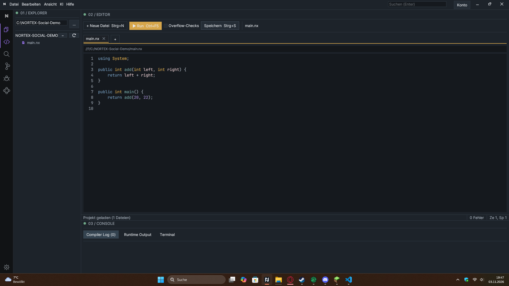
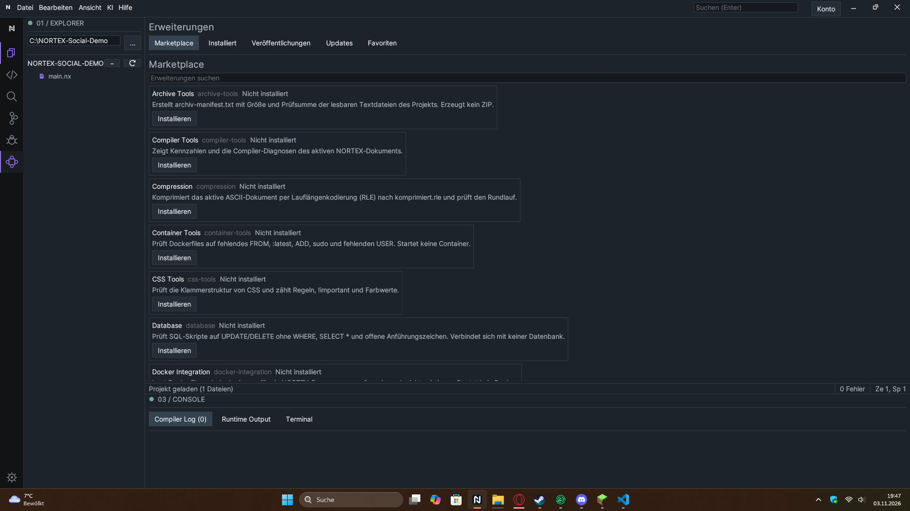
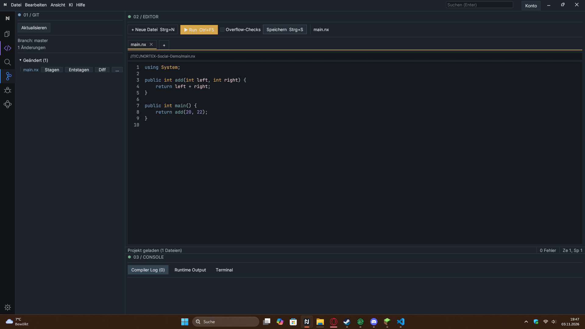
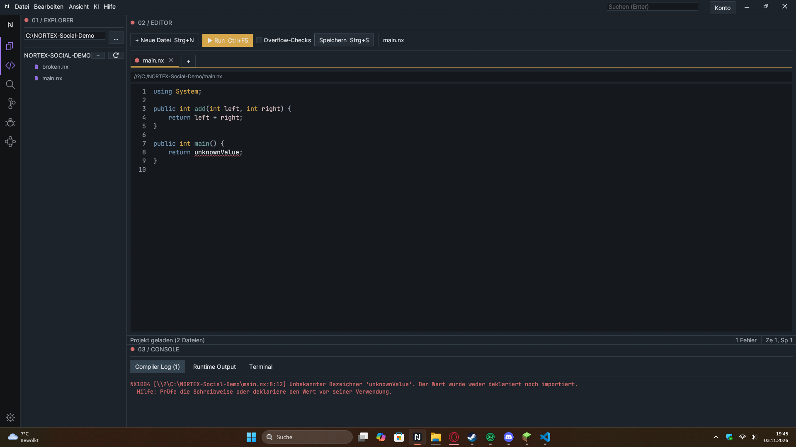

# NORTEX: Ich baue eine Programmiersprache samt nativem Compiler und IDE

Hi, ich bin der Solo-Entwickler von NORTEX. Ich entwickle eine eigene Sprache und die Werkzeuge dazu: Compiler, Runtime und eine Windows-IDE. Das Projekt ist noch im Aufbau.

**Transparenz vorab:** Der vollständige Quellcode ist derzeit nicht öffentlich verlinkt. Dieser Beitrag ist deshalb ein Projekt- und Architektur-Update, keine Bitte um ein Code-Review. Wenn ich gezielt Code-Feedback erfrage, gehört ein direkter Link zum betreffenden Quellcode dazu.

## Was ist NORTEX?

NORTEX ist eine eigene Programmiersprache für native Windows-x64-Programme. Compiler, Runtime und IDE sind überwiegend in Rust geschrieben; Programme werden in NORTEX (`.nx`) geschrieben. Das Ziel ist, den Weg vom lesbaren Quelltext über Compiler-Zwischenstufen bis zur ausführbaren Datei in einem kleinen, selbst gebauten Toolchain-Projekt nachvollziehbar zu machen.

## Wie der Compiler aufgebaut ist

Der Compiler ist in getrennte Stufen gegliedert:

```text
.nx → Lexer → Parser/AST → semantische Prüfung → HIR → MIR/CFG
    → MIR-Validierung und Optimierung → Cranelift → Windows-COFF
    → MSVC-Linker → .exe
```

HIR und MIR bilden Grenzen zwischen Frontend und Backend. Die MIR-Prüfungen decken im unterstützten Teilbereich unter anderem definite assignment und konservative Borrow-/Loan-Regeln ab. Compiler-Diagnosen tragen Code, Meldung, Quelltextspanne, Schweregrad und optionale Hilfe; die IDE zeigt sie unter dem Editor an.

Der interessante Teil ist nicht, dass die Syntax vertraut aussieht, sondern dass ein kleines Sprach-Frontend mit Ownership-Prüfung, eigenem MIR und einem nativen Windows-Backend zusammenarbeiten muss. Der Compiler zielt derzeit auf Windows x64 (MSVC), nicht auf alle Betriebssysteme.

## Ein konkretes Beispiel

```nortex
public int add(int left, int right) {
    return left + right;
}

public int main() {
    return add(20, 22);
}
```

`add` und `main` sind **freie Funktionen auf oberster Ebene**. `add(20, 22)` ist kein Klassen- oder Instanzmethodenaufruf. Die bekannten Namen `Console`, `Convert` und `Text` sind eingebaute, namespace-artige APIs. Das Beispiel gibt den Exitcode `42` zurück.

Wichtig zur Klassenfrage: Der Parser versteht Teile der Klassen- und Methodensyntax, aber Klassen und Instanzmethoden lassen sich derzeit nicht nativ bauen. Sie werden in diesem Beispiel nicht verwendet.

## Was schon sichtbar funktioniert

- Eigener Compiler für native Windows-x64-Programme.
- Rust-basierte IDE mit Editor, Build/Run-Ablauf und Compilerdiagnosen.
- Git-Ansicht mit Dateiänderungen und Staging.
- Lokaler Extension-Katalog und mitgelieferte `.nx`-Extensions.
- `double` sowie `IntList` und `StringList` im nativen Subset; bei Listen ist die Freigabe derzeit explizit.

Der Marketplace-Screenshot zeigt bewusst den **lokalen Katalog**. Die Online-Oberfläche für Anmeldung, Bewertungen und Publisher-Uploads ist derzeit nicht angebunden. Die Extensions sind außerdem noch keine dauerhaft laufenden IDE-Dienste.

## Wo ich noch ehrliches Feedback brauche

1. Sind die Grenzen AST → HIR → MIR für ein kleines Compilerprojekt sinnvoll, oder würdet ihr früher eine konkrete IR anders gestalten?
2. Welche Information sollte eine Compilerdiagnose unbedingt tragen, damit sie in einer IDE wirklich hilfreich ist?
3. Welchen nächsten vertikalen Schritt würdet ihr priorisieren: Klassen/Felder, vollständige Typinferenz oder einen belastbaren Extension-Lifecycle?

Das ist kein fertiges Konkurrenzprodukt zu etablierten Sprachen und IDEs. Es ist ein Solo-Projekt, an dem ich Compiler- und Toolchain-Entwicklung praktisch lerne. Für ein Code-Review werde ich den tatsächlichen öffentlichen Quellcode verlinken, statt abstrakte Feature-Listen als Review-Grundlage auszugeben.

## Screenshots

Die Screenshots stammen aus einem lokalen Build und einem synthetischen Demo-Projekt:









Weitere Ansichten und Beschreibungen: [Screenshot-Galerie](./screenshots/README.md). Reddit-Banner: [reddit-banner.png](./reddit-banner.png).
