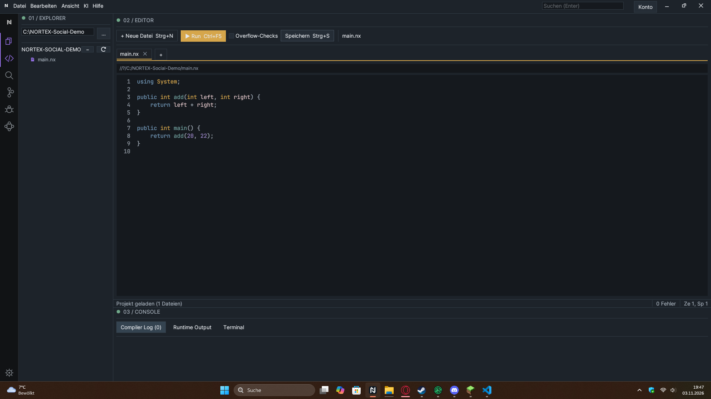
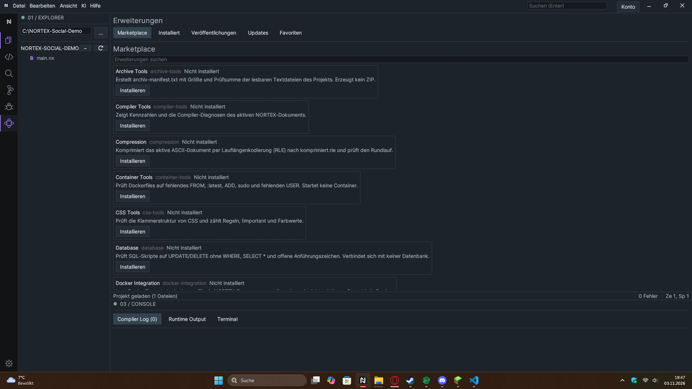
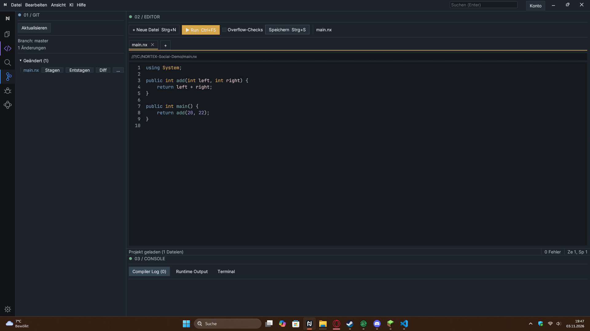
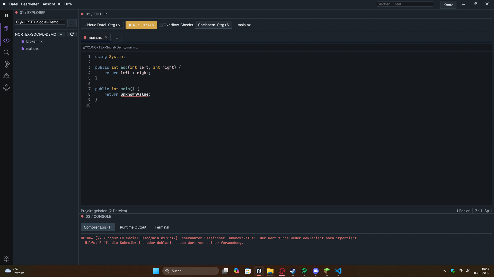

# NORTEX: I'm building a programming language, native compiler, and IDE

Hi, I'm the solo developer of NORTEX. I'm building a language and its toolchain: compiler, runtime, and a Windows IDE. The project is still in progress.

**Transparency first:** The complete source code is not publicly linked yet. This is a project and architecture update, not a request for a code review. When I ask for implementation feedback, I should include a direct link to the relevant source.

## What is NORTEX?

NORTEX is a programming language for native Windows x64 programs. The compiler, runtime, and IDE are primarily written in Rust; applications are written in NORTEX (`.nx`). The goal is to make the path from readable source through compiler stages to an executable something I can build and understand end to end.

## How the compiler is put together

```text
.nx → lexer → parser/AST → semantic checks → HIR → MIR/CFG
    → MIR validation and optimization → Cranelift → Windows COFF
    → MSVC linker → .exe
```

HIR and MIR provide boundaries between the frontend and backend. For the supported subset, MIR validation includes definite-assignment and conservative borrow/loan checks. Compiler diagnostics carry a code, message, source span, severity, and optional help text; the IDE displays them below the editor.

The interesting challenge is not that the syntax looks familiar. It is making a small frontend, ownership checks, a custom MIR, and a native Windows backend work together. The compiler currently targets Windows x64 (MSVC), not every operating system.

## A concrete example

```nortex
public int add(int left, int right) {
    return left + right;
}

public int main() {
    return add(20, 22);
}
```

`add` and `main` are **top-level free functions**. `add(20, 22)` is not a class or instance-method call. Names such as `Console`, `Convert`, and `Text` are built-in, namespace-like APIs. This program returns exit code `42`.

To be clear about classes: the parser understands parts of class and method syntax, but classes and instance methods cannot currently be compiled natively. This example does not use them.

## What currently works

- A compiler for native Windows x64 programs.
- A Rust-based IDE with an editor, build/run flow, and compiler diagnostics.
- A Git view with file changes and staging.
- A local extension catalog and bundled `.nx` extensions.
- `double`, `IntList`, and `StringList` in the native subset; list cleanup is currently explicit.

The marketplace screenshot intentionally shows the **local catalog**. The online UI for sign-in, ratings, and publisher uploads is not connected at the moment. Extensions are also not long-running IDE services yet.

## Where I would value feedback

1. Are AST → HIR → MIR reasonable boundaries for a small compiler project, or would you shape the concrete IR differently earlier?
2. What information must a compiler diagnostic carry to be genuinely useful in an IDE?
3. Which vertical slice would you prioritize next: classes/fields, complete type inference, or a robust extension lifecycle?

This is not a finished replacement for established languages or IDEs. It is a solo project where I'm learning compiler and toolchain development in practice. For a code review, I'll link the actual public source instead of presenting an abstract feature list as review material.

## Screenshots

These are real screenshots from a local build and a synthetic demo project:









More views and captions: [Screenshot gallery](./screenshots/README.md). Reddit banner: [reddit-banner.png](./reddit-banner.png).
