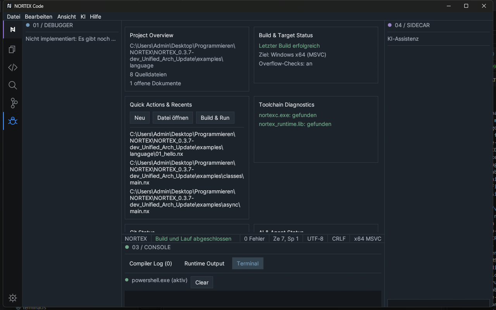

# 2 Installation und erster Start

[Zurück](01-welcome.md) · [Inhaltsverzeichnis](README.md) · [Weiter: Oberfläche](03-interface-overview.md)

## Systemvoraussetzungen

- Windows 10/11, 64 Bit.
- Zum Linken erzeugter Programme: Microsoft-Linker (Visual-Studio-Build-Tools) – siehe [Sprachreferenz, Kapitel 2](../language/02-installation.md).
- Optional: Git (für die Git-Anzeige) und PowerShell (für das Terminal).

## Installation

Entpacke den Programmordner an einen beliebigen Ort. Neben `nortex-code.exe` müssen der Compiler `nortexc.exe` und die Bibliothek `nortex_runtime.lib` liegen. Fehlt etwas, meldet Build & Run das im Compiler Log; das Dashboard zeigt den Zustand der Werkzeuge.

## Starten

`nortex-code.exe` doppelklicken. Der **Arbeitsordner** beim Start wird zum Projektordner (im Explorer-Feld angezeigt). Wer die EXE per Verknüpfung startet, setzt dort den gewünschten „Ausführen in“-Ordner.

## Erster Start

Beim ersten Start öffnet sich das **Dashboard** (Projektübersicht mit Schaltflächen *Neu*, *Datei öffnen*, *Build & Run* und „Toolchain Diagnostics“). Dort steht, ob Compiler und Laufzeitbibliothek gefunden wurden. Beides sollte grün sein.

## Dateien, die die IDE schreibt

- Deine Einstellungen (Theme, Dichte, Zoom, zuletzt geöffnete Dateien) im Ordner `%APPDATA%\NORTEX Code`.
- Beim Bauen: `<name>.exe` neben der Quelldatei (ohne Manifest) bzw. der Ausgabeort laut `nortex.toml`.

## Typische Probleme

| Problem | Lösung |
|---|---|
| Compiler nicht gefunden | `nortexc.exe` neben `nortex-code.exe` legen |
| Laufzeitbibliothek nicht gefunden | `nortex_runtime.lib` neben die EXE legen |
| Linker-Fehler beim Build | Visual-Studio-Build-Tools installieren |
| Terminal startet nicht | Meldung „Shell nicht startbar“; PowerShell muss verfügbar sein |
