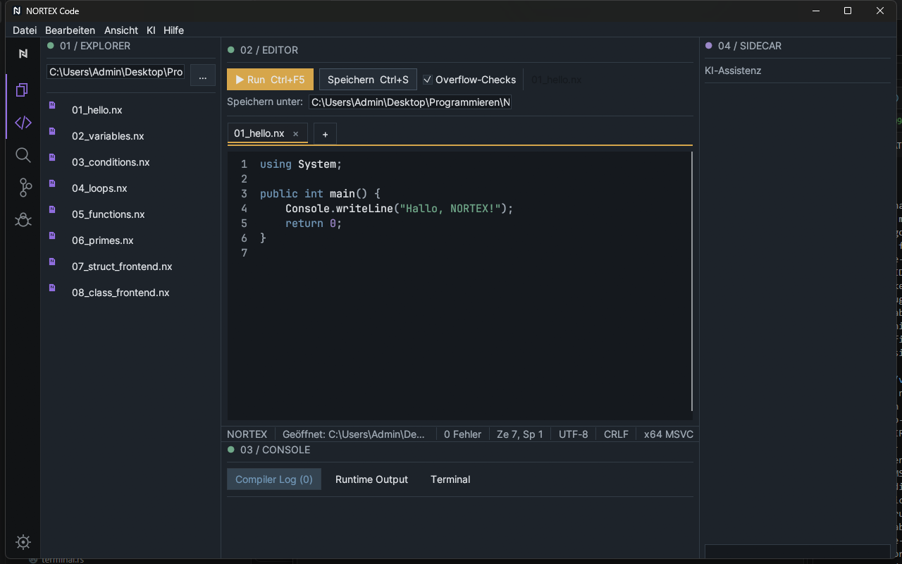
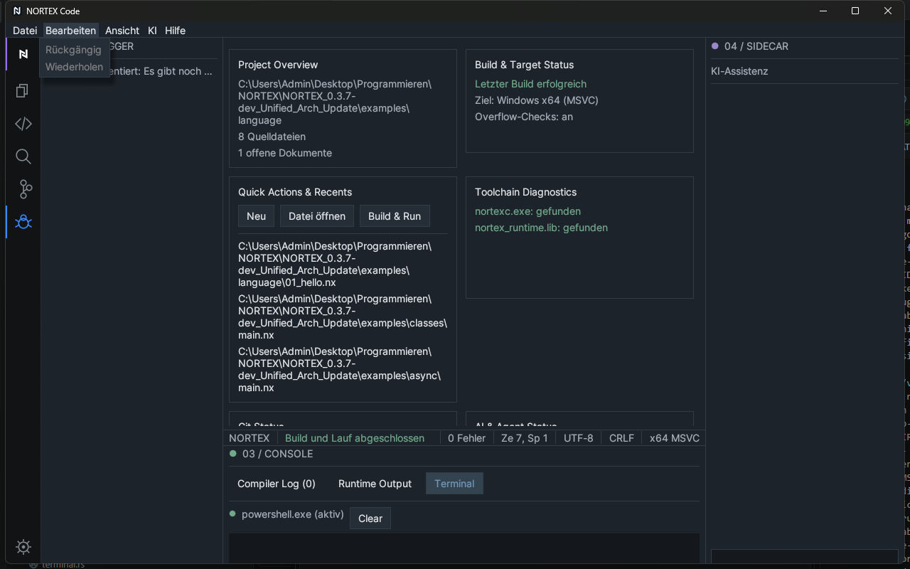
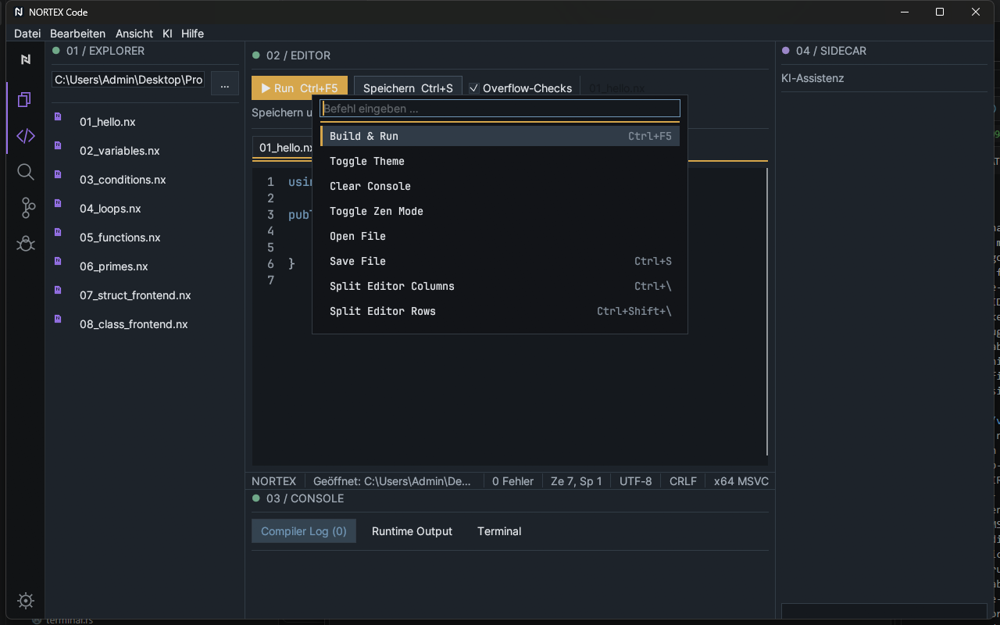

# 3 Benutzeroberfläche

[Zurück](02-installation.md) · [Inhaltsverzeichnis](README.md) · [Weiter: Projekte und Dateien](04-projects-and-files.md)

| Nr. | Bereich | Ort |
|---|---|---|
| 1 | Menüleiste | oben |
| 2 | Activity Bar | ganz links (schmale Icon-Leiste) |
| 3 | Seitenleiste (Explorer, Suche, Git, Debugger) | links neben der Activity Bar |
| 4 | Editorbereich mit Tabs und Run-Leiste | Mitte |
| 5 | Sidecar | rechts |
| 6 | Statusleiste | zwischen Editor und Konsole |
| 7 | Console (Compiler Log, Runtime Output, Terminal) | unten |

Die Panels tragen nummerierte Titel (01 Explorer, 02 Editor, 03 Console, 04 Sidecar, 05 Einstellungen).

## Menüleiste

Menüs: **Datei**, **Bearbeiten**, **Ansicht**, **KI**, **Hilfe**.

| Menü | Einträge |
|---|---|
| Datei | Neue Datei (Strg+N) · Öffnen… · Ordner öffnen… · Speichern (Strg+S) · Speichern unter… · Projektordner schließen (blendet nur die Seitenleiste aus) · Projekt aktualisieren · Projektordner im Explorer öffnen · Beenden |
| Bearbeiten | Rückgängig · Wiederholen (ausgegraut, wenn nichts zu tun ist) · Ausschneiden (Strg+X) · Kopieren (Strg+C) · Einfügen (ausgegraut, nur per Strg+V im Editor) · Alles auswählen (Strg+A) · Suchen (Strg+F) · Suchen/Ersetzen (Strg+H) · Zeile duplizieren · Zeile nach oben/unten · Nächstes Vorkommen auswählen · Block-Kommentar (Strg+/) · Zu Zeile springen… |
| Ansicht | Zen-Modus (F11) · Explorer (Strg+B) · Terminal / Diagnosen (Strg+J) · Statusleiste anzeigen · Seitenleiste (Explorer, Suche, Git, Debugger) · Layout zurücksetzen · Zeilennummern anzeigen · Minimap anzeigen (Strg+Alt+M) · Zoom zurücksetzen · Sidecar (Strg+Umschalt+L) · Editor-Layout (Einzeln, Zwei Spalten, Zwei Zeilen, 2x2 Raster, Pane schließen) · Theme · Dichte · UI-Zoom · Editor-Zoom |
| KI | Hinweis „Noch nicht angebunden – es wird kein Code gesendet.“; alle Einträge (Code erklären, Refactoring-Vorschlag, Fehler analysieren, Tests vorschlagen, Dokumentation generieren) sind deaktiviert, **geplant** |
| Hilfe | Erste Schritte · Diagnoseinformationen kopieren · Lizenz · NORTEX Code-Handbuch · Dokumentationsordner öffnen · Tastatur-Kürzel · Update-Check (meldet nur, dass die Prüfung offline nicht verfügbar ist) · Info |

## Activity Bar

Oben das **N-Logo** (Dashboard), darunter **Explorer**, **Editor**, **Suche**, **Git**, **Debugger**, ganz unten das **Zahnrad** (Einstellungen). Das aktive Symbol trägt einen 2 px breiten Streifen am linken Rand (violett für Explorer/Editor/Dashboard, blau für Git/Debugger). Ein Klick auf das bereits aktive Seitensymbol schaltet die Seitenleiste um (Strg+B).

## Explorer

Zeigt den Projektordner als Baum mit einklappbaren Ordnern. Farbe des Symbols nach Dateityp (`.nx` violett). Klick öffnet die Datei. Oben: Eingabefeld für den Projektordner und **Öffnen**.

## Editorbereich

Obere Zeile: **Run** (Strg+F5), **Speichern**, Kontrollkästchen **Overflow-Checks**, Dateiname. Danach folgen Tabs und Editor. **Datei → Speichern unter…** öffnet den Dateidialog. Details: [Kapitel 5](05-editor.md).

## Tabs

Ein Tab pro geöffneter Datei; **+** legt ein neues Dokument an. Der aktive Tab hat einen helleren Hintergrund und eine Amber-Linie. Ungespeicherte Änderungen zeigt ein Amber-Punkt **•** neben dem stets sichtbaren **×** (Schließen). Bei ungespeicherten Änderungen fragt ein Dialog, ob gespeichert oder verworfen werden soll. Ein roter Punkt **●** markiert den aktiven Tab bei Compilerfehlern. Tabs lassen sich am Dateinamen ziehen, um sie neu zu ordnen oder in ein anderes Pane zu verschieben.

## Console (untere Panels)

Reiter **Compiler Log (n)**, **Runtime Output**, **Terminal**. Ein/Aus: Strg+J oder *Ansicht → Terminal / Diagnosen*. Siehe [Kapitel 7](07-terminal-and-consoles.md).

## Sidecar

Rechtes Panel „KI-Assistenz“ mit Eingabefeld und **Senden**. Es ist an keinen KI-Anbieter angebunden. Anzeige: Strg+Umschalt+L oder *Ansicht → Sidecar*. In schmalen Fenstern wird es automatisch eingeklappt.

## Statusleiste

Von links nach rechts: Projektname · Statusmeldung (grün nach erfolgreichem Lauf, rot bei Fehlern) · Fehleranzahl · Zeile und Spalte. Sie lässt sich unter *Ansicht → Statusleiste* ausblenden.

## Weitere Ansichten

- **Dashboard**: Projektübersicht, Build- und Toolchain-Status, zuletzt geöffnete Dateien.
- **Einstellungen**: Zahnrad ([Kapitel 9](09-settings-and-customization.md)).
- **Befehlspalette**: Strg+Umschalt+P oder F1 ([Kapitel 10](10-keyboard-shortcuts.md)).

**Zen-Modus** (Ansicht-Menü, F11) blendet Nebenbereiche aus; Esc beendet ihn. Kontextmenüs (Rechtsklick) gibt es nicht. Kleine Fenster gibt es für *Zu Zeile springen*, *Hilfe → Lizenz*, *Tastatur-Kürzel*, *Info*, das Handbuch und das Konto-Fenster; für Datei öffnen/speichern dient der Windows-Dateidialog.
