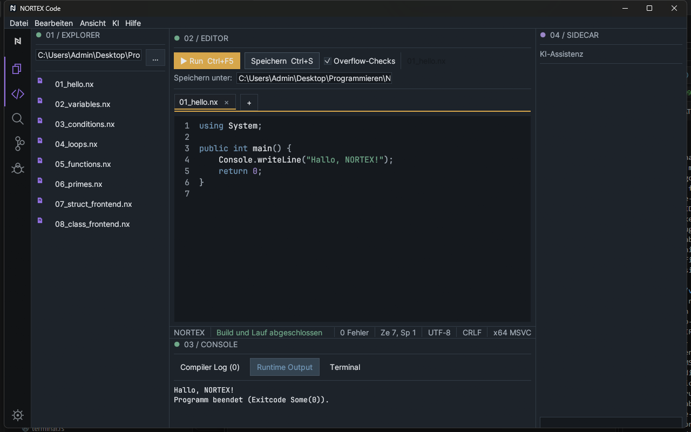

# 6 Kompilieren und Ausführen

[Zurück](05-editor.md) · [Inhaltsverzeichnis](README.md) · [Weiter: Terminal und Konsolen](07-terminal-and-consoles.md)

Nortex Code hat **eine** Build-Funktion: **Build & Run**. Sie speichert, kompiliert mit `nortexc build` und startet die erzeugte EXE.

## Auslösen

| Weg | Hinweis |
|---|---|
| Knopf **▶ Run** | im Editorbereich |
| Strg+F5 | |
| Strg+Umschalt+B | gleiche Funktion (kein reiner Build) |
| Befehlspalette → *Build & Run* | |
| Dashboard → *Build & Run* | |

Während des Bauens zeigt die Leiste „Kompiliere…“; ein zweiter Build kann gleichzeitig nicht starten.

## Ablauf

1. Die aktive Datei wird gespeichert. Bei neuen Dokumenten ohne Pfad erscheint der Speichern-Dialog.
2. **Ohne `nortex.toml`**: `nortexc build <datei.nx> --output <datei.exe> --overflow-checks=<an|aus>`; die EXE liegt neben der Quelldatei.
3. **Mit `nortex.toml`** im Projektordner: gebaut wird das Manifest. Die EXE liegt im Unterordner `build\` des Projekts; Overflow-Checks kommen aus der IDE-Einstellung, sofern das Manifest sie nicht festlegt.
4. Das Compiler-Log zeigt die Compilerausgabe. Danach startet die IDE die EXE; ihre Ausgabe steht im **Runtime Output**, gefolgt von „Programm beendet (Exitcode …)“.

## Ergebnis lesen

- Statusleiste grün: Build erfolgreich. Rot: Compilerfehler. Der **Exitcode des Programms** ist nur ein Wert (Nortex-Programme geben ihn über `return` aus) und färbt nie rot. Im Screenshot steht „Exitcode Some(0)“: das ist die tatsächliche Anzeige der IDE für Exitcode 0.
- Bei Fehlern: Reiter *Compiler Log* ([Kapitel 8](08-debugging.md)).

## Overflow-Checks

Das Kontrollkästchen steuert `--overflow-checks`. An: Ganzzahl-Überlauf führt zu einem Trap (das Programm bricht ab). Aus: Überlauf läuft über (Wraparound). Standard: an in Debug-, aus in Release-Builds der IDE. Dieselbe Option steht in den Einstellungen und im Dashboard.

## Grenzen

- Kein Abbrechen laufender Programme (Shift+F5 zeigt nur einen Hinweis).
- Kein Eingabekanal für laufende Programme.
- Nur der nativ unterstützte Sprachumfang baut ([Sprachreferenz](../language/README.md)); alles andere endet mit NX2001/NX2002.
