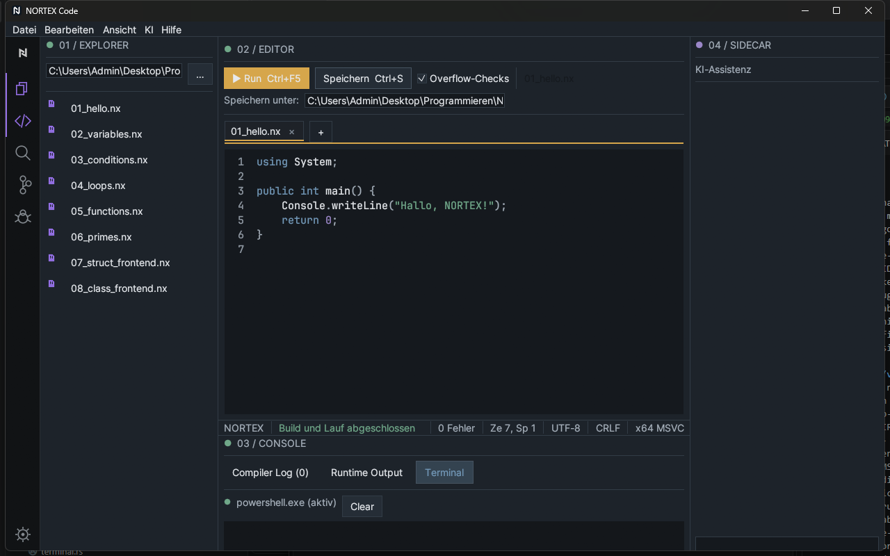

# 7 Terminal und Konsolen

[Zurück](06-build-and-run.md) · [Inhaltsverzeichnis](README.md) · [Weiter: Fehleranalyse und Debugging](08-debugging.md)

Das untere Panel **03 / CONSOLE** hat drei Reiter:

| Reiter | Inhalt | Direkt öffnen |
|---|---|---|
| **Compiler Log (n)** | Compilerausgabe und Diagnosen; *n* = Anzahl | Strg+Umschalt+M |
| **Runtime Output** | Ausgabe des gestarteten Programms und Exitcode | Strg+Umschalt+U |
| **Terminal** | echte PowerShell-Sitzung | Reiter anklicken |

Das Panel ein-/ausblenden: Strg+J oder *Ansicht → Terminal / Diagnosen*. Ein neuer Build leert Compiler Log und Runtime Output. Befehlspalette → *Clear Console* leert beide ebenfalls.

## Terminal

- Beim ersten Öffnen des Reiters startet die Shell (`powershell.exe`) im Hintergrund; die Zeile zeigt „(aktiv)“ bzw. „(beendet)“ mit grünem/rotem Punkt.
- Befehl in das untere Eingabefeld tippen, **Enter** sendet. Die Ausgabe erscheint oben.
- **Clear** oder Strg+L löschen die Anzeige.
- Es ist keine vollwertige Konsole: keine interaktiven Programme, keine Farbcodes.
- Nur **ein** Terminal; mehrere Konsolen oder Terminal-Tabs gibt es nicht.
- Startet die Shell nicht, steht „Shell nicht startbar: …“.
