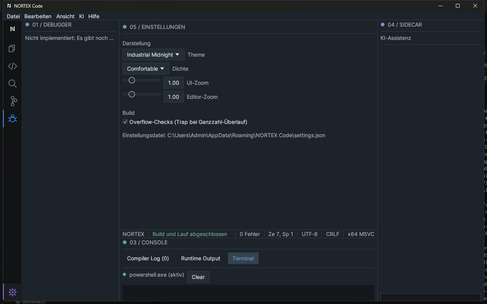

# 9 Einstellungen und Anpassungen

[Zurück](08-debugging.md) · [Inhaltsverzeichnis](README.md) · [Weiter: Tastenkombinationen](10-keyboard-shortcuts.md)

Öffnen: **Zahnrad** unten in der Activity Bar (nochmals klicken kehrt zum Editor zurück). Die Darstellungs-Regler stehen auch im Menü *Ansicht*.

## Aufbau der Einstellungsansicht

- **Suche** (oben): sucht in Titel, Beschreibung und Stichwörtern. Alle eingegebenen Wörter müssen passen. Die Suche filtert auch die Tabelle der Tastenkürzel.
- **Ebenenfilter**: *Alle Ebenen*, *Benutzer*, *Projekt* oder *Erweitert*. *Benutzer* sind persönliche Vorgaben. *Projekt* ist für projektspezifische Werte gedacht; diese Einträge sind **vorbereitet, aber noch ohne Wirkung** (siehe „Geplant“). *Erweitert* enthält Spezialoptionen.
- **7 Kategorien**: Darstellung · Editor · Tastenkürzel · Sprache und Code-Hilfe · Build und Debug · Konto und Synchronisierung · System, Sicherheit und Updates.
- Geänderte Einträge tragen einen Punkt **•**; **↺** setzt den einzelnen Eintrag auf den Standard zurück.

## Zurücksetzen, Export und Import

| Aktion | Wirkung |
|---|---|
| **↺** am Eintrag | setzt diesen Eintrag zurück |
| **Kategorie zurücksetzen** | setzt alle *aktiven* Einstellungen der Kategorie zurück |
| **Alle zurücksetzen** | setzt alle aktiven Einstellungen zurück; die Liste der zuletzt geöffneten Dateien bleibt erhalten |
| **Exportieren…** | speichert die Einstellungen als JSON (Vorschlag `nortex-code-settings.json`) |
| **Importieren…** | liest eine JSON-Datei; ungültige Dateien werden mit einer Meldung abgelehnt, ungültige Einzelwerte fallen auf den Standard zurück. Die eigene Liste der zuletzt geöffneten Dateien bleibt unverändert |

Die Einstellungen werden automatisch im Ordner `%APPDATA%\NORTEX Code` gespeichert (der Pfad steht am Ende der Ansicht). Beschädigte Dateien werden beim Start repariert.

## Aktive Einstellungen

| Einstellung | Kategorie | Standard | Wirkung |
|---|---|---|---|
| **Farbschema** | Darstellung | Industrial Midnight | Industrial Midnight, Professional Dark oder High Contrast. Befehlspalette → *Toggle Theme* wechselt zum nächsten |
| **Dichte** | Darstellung | Comfortable | Compact, Comfortable oder Spacious: Abstände der Oberfläche |
| **Oberflächen-Zoom** | Darstellung | 100 % | 70–200 %; Strg+Mausrad ändert ihn in 10-%-Schritten |
| **Editor-Zoom** | Darstellung | 100 % | 70–200 %, Editorschrift |
| **Statusleiste anzeigen** | Darstellung | an | blendet die Statusleiste ein/aus |
| **Zeilennummern anzeigen** | Editor | an | Zeilennummernspalte |
| **Minimap anzeigen** | Editor | aus | auch Strg+Alt+M |
| **Automatisch speichern** | Editor | aus | speichert geänderte Dokumente **mit Dateipfad** höchstens alle 30 Sekunden; neue Dokumente ohne Pfad werden nicht gespeichert |
| **Overflow-Checks** | Build und Debug | an in Debug-Builds der IDE, aus in Release-Builds | Trap bei Ganzzahl-Überlauf; ein `nortex.toml` kann den Wert überschreiben. Gleiche Option wie im Editorbereich ([Kapitel 6](06-build-and-run.md#overflow-checks)) |

Der Zoom-Regler arbeitet in 10-%-Schritten und wirkt nach dem Loslassen; genauere Werte gibst du direkt ein. Eingegebene Prozentwerte werden erst mit Enter oder nach Verlassen des Feldes übernommen. Ungültige Werte in der Datei fallen beim Laden auf den Standard zurück.

## Geplant (sichtbar, aber ausgegraut und ohne Wirkung)

Diese Einträge zeigt die Ansicht mit dem Hinweis „geplant“; der Mauszeiger nennt den Grund.

- Editor: Tabulatorbreite, Zeilenumbruch, Leerzeichen anzeigen, Beim Speichern formatieren, Klammerpaare hervorheben, Editorschrift
- Sprache und Code-Hilfe: Live-Diagnose, Automatische Vervollständigung (beide sind immer aktiv und noch nicht abschaltbar), Inline-Hinweise
- Build und Debug: Standard-Buildprofil, Zusätzliche Compiler-Argumente, Arbeitsverzeichnis (Projektebene fehlt), Prozess-Zeitlimit, Beim Start anhalten (Debugger noch nicht verfügbar, siehe [Kapitel 8](08-debugging.md))
- Konto: Einstellungen synchronisieren
- System: Update-Kanal, Nutzungsdaten, Arbeitsbereich-Vertrauen. Zu den Nutzungsdaten: Es werden derzeit keine Daten erhoben.

## Tastenkürzel

Die Kategorie zeigt die aktuelle Belegung als Tabelle. **Anpassen ist noch nicht möglich.** Vollständige Liste: [Kapitel 10](10-keyboard-shortcuts.md).

## Konto und Synchronisierung

- **Lokaler Modus**: Es gibt kein Konto-System im Sinne eines Online-Dienstes. Die IDE läuft vollständig lokal; Editor, Compiler, Build und Projekte brauchen kein Konto.
- Der Menüpunkt **Konto** und der Knopf *Nortex-Konto öffnen…* zeigen den Status „Lokaler Modus“. *Im Browser anmelden* meldet, dass der Kontodienst noch nicht verfügbar ist. Es wird keine Anmeldung vorgetäuscht.
- **Synchronisierung**: Vier Schalter (Einstellungen, Themes, Tastenkürzel, Liste der Erweiterungen) sind nur **vorbereitet**. Sie werden gespeichert, wirken aber erst nach einer Anmeldung, die es noch nicht gibt. Standardmäßig sind alle aus.
- **Quellcode bleibt lokal**: Quellcode, Projekte und Dateien verlassen den Rechner nie; sie gehören nicht zu den synchronisierbaren Daten.
- Geplant (nur als ausgegraute Einträge sichtbar): KI-Funktionen, Erweiterungen, Lizenz, Geräte. Eine spätere Anmeldung erfolgt über den Systembrowser, ohne Passwörter in der IDE.

## Fensteraufteilung

- Seitenleiste: Strg+B · Console: Strg+J · Sidecar: Strg+Umschalt+L · Zen-Modus: F11 oder *Ansicht*.
- Editor-Layout: [Kapitel 5](05-editor.md#tabs-und-geteilter-editor).
- Die Panelbreiten und -höhen sind in Grenzen per Ziehen anpassbar. Panels lassen sich nicht frei verschieben oder andocken.

## Nicht anpassbar

Tastenkombinationen, Schriftart, Farben einzelner Elemente und Panelposition (Seitenleiste immer links, Sidecar rechts, Console unten).
