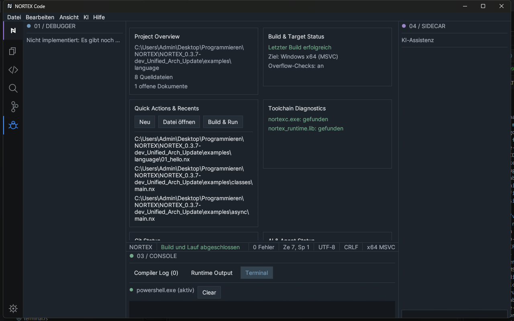

# 2 Installation and first start

[Back](01-welcome.md) · [Contents](README.md) · [Next: Interface](03-interface-overview.md)

## System requirements

- Windows 10/11, 64-bit.
- To link generated programs: the Microsoft linker (Visual Studio Build Tools) – see [Language reference, chapter 2](../../language/02-installation.md).
- Optional: Git (for the Git view) and PowerShell (for the terminal).

## Installation

Unpack the program folder anywhere. Next to `nortex-code.exe` there must be the compiler `nortexc.exe` and the library `nortex_runtime.lib`. If something is missing, Build & Run reports it in the Compiler Log; the dashboard shows the state of the tools.

## Starting

Double-click `nortex-code.exe`. The **working directory** at start becomes the project folder (shown in the Explorer field). If you start the EXE from a shortcut, set the desired "Start in" folder there.

## First start

On first start the **dashboard** opens (project overview with the buttons *New*, *Open file*, *Build & Run* and "Toolchain Diagnostics"). It shows whether the compiler and the runtime library were found. Both should be green.

## Files written by the IDE

- Your settings (theme, density, zoom, language, recently opened files) in the folder `%APPDATA%\NORTEX Code`.
- When building: `<name>.exe` next to the source file (without a manifest) or the output location given in `nortex.toml`.

## Common problems

| Problem | Solution |
|---|---|
| Compiler not found | Put `nortexc.exe` next to `nortex-code.exe` |
| Runtime library not found | Put `nortex_runtime.lib` next to the EXE |
| Linker error during build | Install the Visual Studio Build Tools |
| Terminal does not start | Message "Shell cannot be started"; PowerShell must be available |
