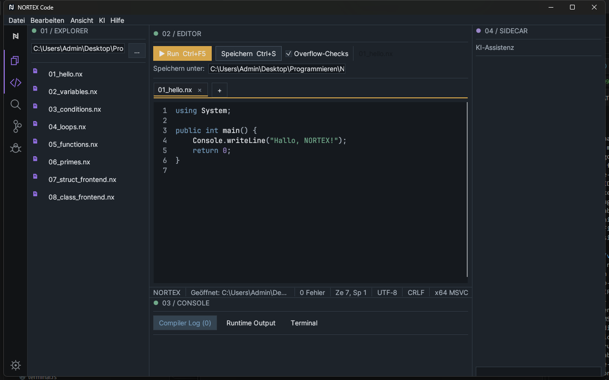
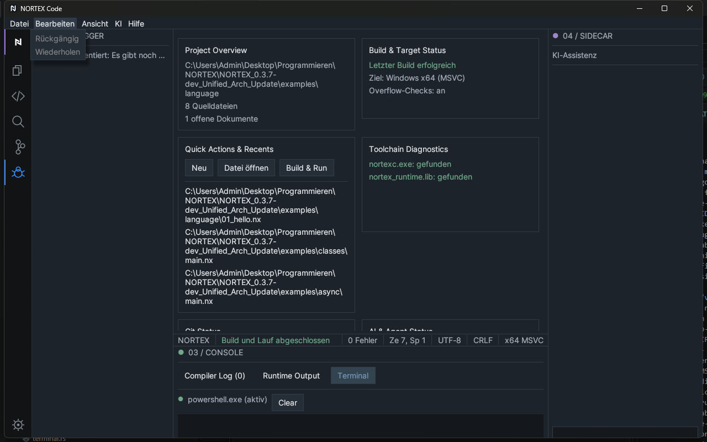
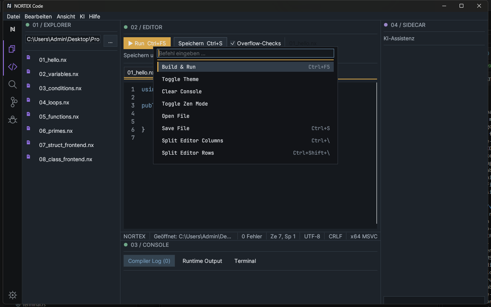

# 3 User interface

[Back](02-installation.md) · [Contents](README.md) · [Next: Projects and files](04-projects-and-files.md)

| No. | Area | Location |
|---|---|---|
| 1 | Menu bar | top |
| 2 | Activity bar | far left (narrow icon strip) |
| 3 | Side bar (Explorer, Search, Git, Debugger) | left of the activity bar |
| 4 | Editor area with tabs and run bar | center |
| 5 | Sidecar | right |
| 6 | Status bar | between editor and console |
| 7 | Console (Compiler Log, Runtime Output, Terminal) | bottom |

## Menu bar

Menus: **File**, **Edit**, **View**, **AI**, **Help**.

| Menu | Entries |
|---|---|
| File | New file (Ctrl+N) · Open… · Open folder… · Save (Ctrl+S) · Save as… · Close project folder (only hides the side bar) · Refresh project · Open project folder in Explorer · Exit |
| Edit | Undo · Redo (greyed out when there is nothing to do) · Cut (Ctrl+X) · Copy (Ctrl+C) · Paste (greyed out, only via Ctrl+V in the editor) · Select all (Ctrl+A) · Find (Ctrl+F) · Find/Replace (Ctrl+H) · Duplicate line · Move line up/down · Select next occurrence · Toggle block comment (Ctrl+/) · Go to line… |
| View | Zen mode (F11) · Explorer (Ctrl+B) · Terminal / Diagnostics (Ctrl+J) · Show status bar · Side bar (Explorer, Search, Git, Debugger) · Reset layout · Show line numbers · Show minimap (Ctrl+Alt+M) · Reset zoom · Sidecar (Ctrl+Shift+L) · Editor layout (Single, Two columns, Two rows, 2x2 grid, Close pane) · Theme · Density · UI zoom · Editor zoom · Language |
| AI | Note "Not connected yet – no code is sent."; all entries (Explain code, Refactoring suggestion, Analyze error, Suggest tests, Generate documentation) are disabled, **planned** |
| Help | Getting started · Copy diagnostic information · License · NORTEX Code manual · Open documentation folder · Keyboard shortcuts · Update check (only reports that the check is unavailable offline) · About |

## Activity bar

At the top the **N logo** (dashboard), below it **Explorer**, **Editor**, **Search**, **Git**, **Debugger**, and at the very bottom the **gear** (settings). The active icon has a 2 px strip on its left edge (purple for Explorer/Editor/Dashboard, blue for Git/Debugger). Clicking the already active side icon toggles the side bar (Ctrl+B).

## Explorer

Shows the project folder as a tree with collapsible folders. The icon color depends on the file type (`.nx` purple). A click opens the file. At the top: an input field for the project folder and **Open**.

## Editor area

Top row: **Run** (Ctrl+F5), **Save**, the checkbox **Overflow checks**, file name. Tabs and the editor follow. **File → Save as…** opens the file dialog. Details: [Chapter 5](05-editor.md).

## Tabs

One tab per open file; **+** creates a new document. The active tab has a lighter background and an amber line. Unsaved changes are shown by an amber dot **•** next to the always visible **×** (close). With unsaved changes a dialog asks whether to save or discard. A red dot **●** marks the active tab when there are compiler errors. Tabs can be dragged by their file name to reorder them or to move them to another pane.

## Console (bottom panels)

Tabs **Compiler Log (n)**, **Runtime Output**, **Terminal**. Toggle with Ctrl+J or *View → Terminal / Diagnostics*. See [Chapter 7](07-terminal-and-consoles.md).

## Sidecar

Right panel "AI assistance" with an input field and **Send**. It is not connected to any AI provider. Toggle with Ctrl+Shift+L or *View → Sidecar*. In narrow windows it collapses automatically.

## Status bar

From left to right: project name · status message (green after a successful run, red on errors) · error count · line and column. It can be hidden under *View → Status bar*.

## Other views

- **Dashboard**: project overview, build and toolchain status, recently opened files.
- **Settings**: gear icon ([Chapter 9](09-settings-and-customization.md)).
- **Command palette**: Ctrl+Shift+P or F1 ([Chapter 10](10-keyboard-shortcuts.md)).

**Zen mode** (View menu, F11) hides secondary areas; Esc exits it. There are no context menus (right-click). Small windows exist for *Go to line*, *Help → License*, *Keyboard shortcuts*, *About*, the manual and the account window; the Windows file dialog is used for opening/saving files.
