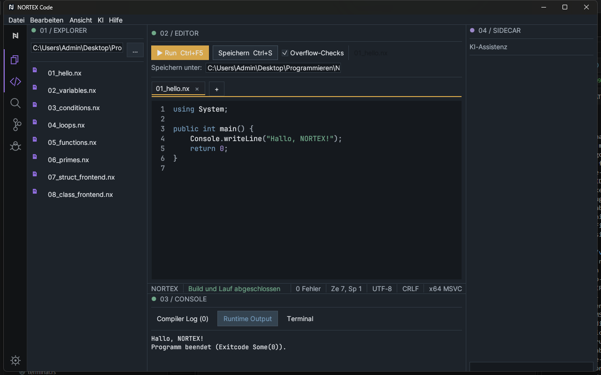

# 6 Build and run

[Back](05-editor.md) · [Contents](README.md) · [Next: Terminal and consoles](07-terminal-and-consoles.md)

Nortex Code has **one** build function: **Build & Run**. It saves, compiles with `nortexc build` and starts the generated EXE.

## Triggering

| Way | Note |
|---|---|
| **▶ Run** button | in the editor area |
| Ctrl+F5 | |
| Ctrl+Shift+B | same function (no build-only mode) |
| Command palette → *Build & Run* | |
| Dashboard → *Build & Run* | |

While building the bar shows "Compiling…"; a second build cannot start at the same time.

## Sequence

1. The active file is saved. For new documents without a path the save dialog appears.
2. **Without `nortex.toml`**: `nortexc build <file.nx> --output <file.exe> --overflow-checks=<on|off>`; the EXE is placed next to the source file.
3. **With `nortex.toml`** in the project folder: the manifest is built. The EXE is placed in the project's `build\` subfolder; overflow checks come from the IDE setting unless the manifest defines them.
4. The compiler log shows the compiler output. Then the IDE starts the EXE; its output appears in **Runtime Output**, followed by "Program finished (exit code …)".

## Reading the result

- Status bar green: build succeeded. Red: compiler errors. The **program's exit code** is just a value (Nortex programs return it via `return`) and never turns red. In the screenshot "Exitcode Some(0)" is the IDE's actual display for exit code 0.
- On errors: *Compiler Log* tab ([Chapter 8](08-debugging.md)).

## Overflow checks

The checkbox controls `--overflow-checks`. On: integer overflow causes a trap (the program aborts). Off: overflow wraps around. Default: on in debug builds, off in release builds of the IDE. The same option is in the settings and on the dashboard.

## Limits

- Running programs cannot be cancelled (Shift+F5 only shows a notice).
- No input channel for running programs.
- Only the natively supported language subset builds ([Language reference](../../language/README.md)); everything else ends with NX2001/NX2002.
