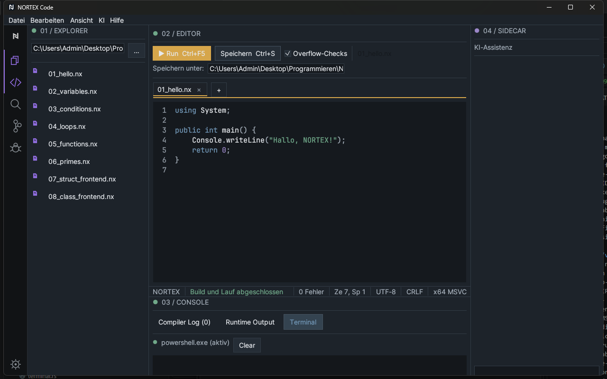

# 7 Terminal and consoles

[Back](06-build-and-run.md) · [Contents](README.md) · [Next: Error analysis and debugging](08-debugging.md)

The bottom panel **03 / CONSOLE** has three tabs:

| Tab | Content | Open directly |
|---|---|---|
| **Compiler Log (n)** | Compiler output and diagnostics; *n* = count | Ctrl+Shift+M |
| **Runtime Output** | Output of the started program and exit code | Ctrl+Shift+U |
| **Terminal** | real PowerShell session | click the tab |

Show/hide the panel: Ctrl+J or *View → Terminal / Diagnostics*. A new build clears Compiler Log and Runtime Output. Command palette → *Clear Console* clears both as well.

## Terminal

- When the tab is first opened the shell (`powershell.exe`) starts in the background; the line shows "(active)" or "(ended)" with a green/red dot.
- Type a command in the lower input field, **Enter** sends it. The output appears above.
- **Clear** or Ctrl+L clears the display.
- It is not a full console: no interactive programs, no color codes.
- Only **one** terminal; multiple consoles or terminal tabs do not exist.
- If the shell does not start, "Shell cannot be started: …" is shown.
