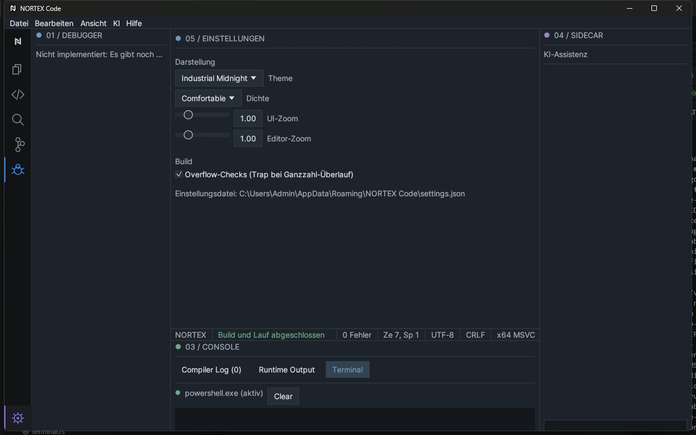

# 9 Settings and customization

[Back](08-debugging.md) · [Contents](README.md) · [Next: Keyboard shortcuts](10-keyboard-shortcuts.md)

Open: **gear** at the bottom of the activity bar (clicking again returns to the editor). The appearance controls are also in the *View* menu.

## Layout of the settings view

- **Search** (top): searches title, description and keywords. All typed words must match. The search also filters the shortcut table.
- **Level filter**: *All levels*, *User*, *Project* or *Advanced*. *User* are personal defaults. *Project* is intended for project-specific values; these entries are **prepared but without effect yet** (see "Planned"). *Advanced* contains special options.
- **7 categories**: Appearance · Editor · Shortcuts · Language and code help · Build and debug · Account and sync · System, security and updates.
- Changed entries carry a dot **•**; **↺** resets the single entry to its default.

## Reset, export and import

| Action | Effect |
|---|---|
| **↺** on an entry | resets this entry |
| **Reset category** | resets all *active* settings of the category |
| **Reset all** | resets all active settings; the list of recently opened files is kept |
| **Export…** | saves the settings as JSON (suggested name `nortex-code-settings.json`) |
| **Import…** | reads a JSON file; invalid files are rejected with a message, invalid single values fall back to the default. Your own list of recently opened files stays unchanged |

Settings are saved automatically in the folder `%APPDATA%\NORTEX Code` (the path is shown at the end of the view). Damaged files are repaired at start.

## Active settings

| Setting | Category | Default | Effect |
|---|---|---|---|
| **Color scheme** | Appearance | Industrial Midnight | Industrial Midnight, Professional Dark or High Contrast. Command palette → *Toggle Theme* switches to the next one |
| **Density** | Appearance | Comfortable | Compact, Comfortable or Spacious: spacing of the interface |
| **Language** | Appearance | German | German or English; applies immediately and is saved |
| **Interface zoom** | Appearance | 100 % | 70–200 %; Ctrl+mouse wheel changes it in 10 % steps |
| **Editor zoom** | Appearance | 100 % | 70–200 %, editor font |
| **Show status bar** | Appearance | on | shows/hides the status bar |
| **Show line numbers** | Editor | on | line number column |
| **Show minimap** | Editor | off | also Ctrl+Alt+M |
| **Auto save** | Editor | off | saves modified documents **with a file path** at most every 30 seconds; new documents without a path are not saved |
| **Overflow checks** | Build and debug | on in debug builds of the IDE, off in release builds | Trap on integer overflow; a `nortex.toml` can override the value. Same option as in the editor area ([Chapter 6](06-build-and-run.md#overflow-checks)) |

The zoom slider works in 10 % steps and takes effect on release; enter more precise values directly. Typed percentages are only applied with Enter or after leaving the field. Invalid values in the file fall back to the default on load.

## Planned (visible, but greyed out and without effect)

These entries are shown with the note "planned"; the tooltip names the reason.

- Editor: tab width, word wrap, show whitespace, format on save, highlight bracket pairs, editor font
- Language and code help: live diagnostics, auto-completion (both are always on and cannot be disabled yet), inline hints
- Build and debug: default build profile, additional compiler arguments, working directory (project level missing), process time limit, stop on start (debugger not available yet, see [Chapter 8](08-debugging.md))
- Account: synchronize settings
- System: update channel, usage data, workspace trust. Regarding usage data: no data is currently collected.

## Shortcuts

The category shows the current assignment as a table. **Customizing is not possible yet.** Full list: [Chapter 10](10-keyboard-shortcuts.md).

## Account and synchronization

- **Local mode**: There is no account system in the sense of an online service. The IDE runs entirely locally; editor, compiler, build and projects need no account.
- The **Account** menu item and the button *Open Nortex account…* show the status "Local mode". *Sign in with browser* reports that the account service is not available yet. No sign-in is faked.
- **Synchronization**: Four switches (settings, themes, shortcuts, list of extensions) are only **prepared**. They are saved but only take effect after a sign-in, which does not exist yet. All are off by default.
- **Source code stays local**: source code, projects and files never leave the computer; they are not among the synchronizable data.
- Planned (only visible as greyed-out entries): AI features, extensions, license, devices. A later sign-in will use the system browser, without passwords in the IDE.

## Window layout

- Side bar: Ctrl+B · Console: Ctrl+J · Sidecar: Ctrl+Shift+L · Zen mode: F11 or *View*.
- Editor layout: [Chapter 5](05-editor.md#tabs-and-split-editor).
- Panel widths and heights can be adjusted within limits by dragging. Panels cannot be freely moved or docked.

## Not customizable

Key bindings, font, colors of individual elements and panel position (side bar always left, sidecar right, console bottom).
